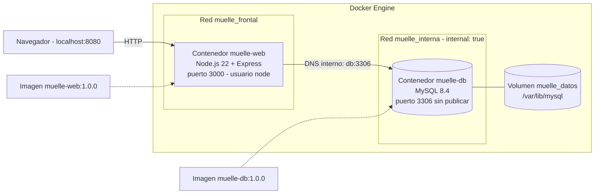
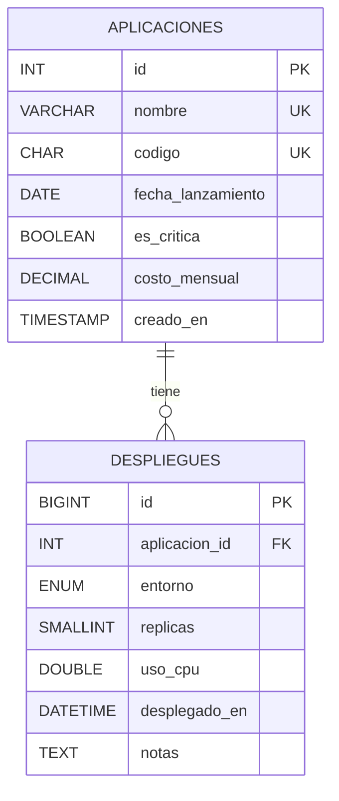

<div align="center">

# Muelle - Contenerización de Aplicaciones de Software - Aplicación Web Node.js y MySQL Desplegada con Docker

</div>

---

Este repositorio contiene **Muelle**, la solución de la **Actividad Sumativa de la Unidad 2: Creación de aplicación contenerizada en Docker**. Es un registro de aplicaciones y de sus despliegues: una interfaz web en **Node.js + Express** que guarda la información en **MySQL 8.4**, cada uno dentro de su propio contenedor, con **imágenes propias** para el servidor web y para la base de datos, orquestadas con **Docker Compose**.

La base de datos sigue un modelo entidad-relación **1:N** entre dos tablas de **7 columnas cada una** que, en conjunto, usan **13 tipos de datos distintos**. La aplicación permite ingresar los datos por formulario y consultarlos en un enlace diferente, y el repositorio incluye un recorrido guiado de **47 comandos Docker** para el video.

## Contenido del repositorio:

- `docker-compose.yml` → Orquesta los **2 contenedores** con dos redes (la de la base de datos es interna y no publica puertos), un volumen con nombre, healthchecks, arranque ordenado y límites de CPU y memoria.
- `database/Dockerfile` → **Imagen de base de datos relacional** basada en `mysql:8.4`, con configuración propia y healthcheck.
- `database/init/01_esquema.sql` → **Script de la base de datos**: tablas `aplicaciones` y `despliegues`, llave foránea, restricciones CHECK, índices y la vista `v_despliegues_detalle`.
- `database/init/02_privilegios.sh` → Aplica **mínimo privilegio**: el usuario de la app solo puede leer y escribir filas.
- `database/conf/muelle.cnf` → Configuración de MySQL: `utf8mb4`, hora de Colombia y modo estricto.
- `web/Dockerfile` → **Imagen del servidor web**: construcción en dos etapas sobre `node:22-alpine`, usuario sin privilegios y healthcheck.
- `web/src/` → Aplicación **Express**: páginas EJS, API REST, validación, acceso a datos con consultas parametrizadas y apagado ordenado ante SIGTERM.
- `web/test/` → Pruebas unitarias de las reglas de validación (`npm test`).
- `demo-imagen/` → Imagen mínima de nginx para mostrar en el video cómo se crea y elimina una imagen y un contenedor.
- `scripts/comandos.tsv` → Catálogo de los comandos del video, con componente de la arquitectura y explicación.
- `scripts/demo-comandos.ps1` y `scripts/demo-comandos.sh` → Ejecutan el catálogo paso a paso (Windows y Linux/macOS).
- `scripts/prueba-humo.sh` → Prueba de punta a punta contra los contenedores: 29 verificaciones.
- `docs/comandos-docker.md` → Guía de comandos organizada por componente de la arquitectura de Docker.
- `docs/guion-video.md` → Guion del video, alineado con la rúbrica.
- `docs/datos-de-prueba.md` → Los 20 registros de ejemplo (5 aplicaciones y 15 despliegues).

## Arquitectura



## Modelo entidad-relación



MySQL implementa `BOOLEAN` como `TINYINT(1)`, y así lo reporta la página **Contenedores**. La llave foránea usa `ON DELETE RESTRICT`: no se puede borrar una aplicación que aún tiene despliegues, y no se puede registrar un despliegue de una aplicación inexistente.

## Ejecución:

1. Instalar **Docker Desktop** (en Windows, con el motor WSL 2) y verificar con `docker version`.
2. Clonar el repositorio:
   ```bash
   git clone https://github.com/AlejoTechEngineer/muelle-docker-node-mysql.git
   cd muelle-docker-node-mysql
   ```
3. Construir las imágenes y levantar los contenedores:
   ```bash
   docker compose up -d --build
   ```
4. Esperar a que ambos servicios aparezcan como `healthy`:
   ```bash
   docker compose ps
   ```
5. Abrir **http://localhost:8080** en el navegador.

| Página | Ruta | Para qué |
|---|---|---|
| Inicio | `/` | Resumen y avance hacia la meta de 15 registros |
| Registrar aplicación | `/aplicaciones/nueva` | Formulario de la tabla padre |
| Registrar despliegue | `/despliegues/nuevo` | Formulario de la tabla hija |
| Registros | `/registros` | Enlace diferente que muestra lo guardado en MySQL |
| Contenedores | `/sistema` | Evidencia de ejecución en Docker: ID de contenedor, imagen, cgroups, red y permisos |
| API | `/api/aplicaciones`, `/api/despliegues`, `/api/sistema` | Los mismos datos en JSON |
| Salud | `/health`, `/ready` | Usados por el healthcheck |

Para consultar MySQL directamente dentro de su contenedor:

```bash
docker compose exec db mysql -umuelle_app -pMuelle_App_2026 muelle -e "SELECT * FROM v_despliegues_detalle"
```

Para detener todo conservando los datos: `docker compose down`. Para borrar también los datos: `docker compose down -v`.

Las credenciales por defecto son de laboratorio. Para cambiarlas, copiar `.env.example` como `.env` y editar los valores antes del primer arranque.

## Pruebas

```bash
# Pruebas unitarias de validación (sin Docker)
cd web && npm install && npm test

# Prueba de punta a punta contra los contenedores en ejecución
./scripts/prueba-humo.sh http://localhost:8080
```

La prueba de punta a punta inserta 5 aplicaciones y 15 despliegues por la API, verifica que se rechacen datos inválidos y duplicados, comprueba la integridad referencial en ambos sentidos y confirma que los registros quedaron persistidos. Escribe datos reales: para empezar de cero, `docker compose down -v`.

La prueba de persistencia está en la sección 3 del recorrido guiado: se destruyen los contenedores, se crean otros nuevos y los datos siguen en el volumen.

## Buenas prácticas aplicadas

- **Imágenes propias** para web y base de datos, con etiquetas OCI y versión fija.
- Construcción **multietapa** y `.dockerignore`: la imagen final no lleva herramientas de construcción, pruebas ni caché.
- Proceso web con **usuario sin privilegios**, sistema de archivos de **solo lectura**, sin capacidades del kernel y con `no-new-privileges`.
- **Healthchecks** en las dos imágenes y arranque condicionado (`service_healthy`): la web no inicia hasta que MySQL está listo.
- **Red interna** para MySQL: sin puertos publicados, solo alcanzable desde el contenedor web por DNS de Docker.
- **Volumen con nombre** para la persistencia, independiente del ciclo de vida de los contenedores.
- **Mínimo privilegio** en MySQL y **consultas parametrizadas** contra inyección SQL.
- **Protección CSRF** sin sesiones: las peticiones que modifican datos se rechazan (403) si el navegador indica, con `Sec-Fetch-Site` u `Origin`, que vienen de otro sitio.
- Puerto publicado **solo en `127.0.0.1`**: la aplicación no queda expuesta a otros equipos de la red.
- Validación en el navegador y en el servidor, replicando las restricciones CHECK de la base de datos.
- **Apagado ordenado**: la app atiende SIGTERM (`docker stop`) y cierra sus conexiones antes de salir; `init: true` agrega un PID 1 que reenvía señales.
- Configuración por **variables de entorno**, sin secretos en el código.
- `.gitattributes` fuerza finales de línea LF en scripts que corren en Linux, para que el proyecto funcione aunque se clone en Windows.

## Seguridad y alcance

Muelle es un laboratorio académico pensado para ejecutarse en el equipo local. Por eso:

- **No tiene autenticación de usuarios.** Cualquiera que acceda a la interfaz puede crear y eliminar registros. Se mitiga publicando el puerto solo en `127.0.0.1` y rechazando peticiones de otros sitios (CSRF). En un despliegue real habría que agregar inicio de sesión, por ejemplo con un proveedor OIDC detrás de un proxy inverso.
- **Las credenciales por defecto de `docker-compose.yml` son públicas** y sirven solo para desarrollo. Para cualquier otro uso, define valores propios en `.env` (ver `.env.example`) antes del primer arranque o, mejor, usa Docker secrets: la aplicación ya admite `DB_PASSWORD_FILE` y la imagen de MySQL admite `MYSQL_PASSWORD_FILE`.
- MySQL no publica puertos y solo es alcanzable por la red interna de Docker.

## Autor:

Este proyecto fue desarrollado en el marco del módulo **Contenerización de Aplicaciones de Software** de la **Maestría en Arquitectura de Software** del **Politécnico Grancolombiano** (Bogotá, Colombia).

- ***Alejandro De Mendoza*** – [Perfil GitHub](https://github.com/AlejoTechEngineer)
