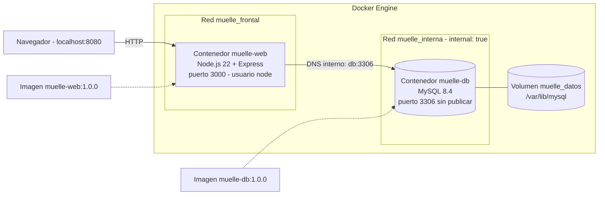
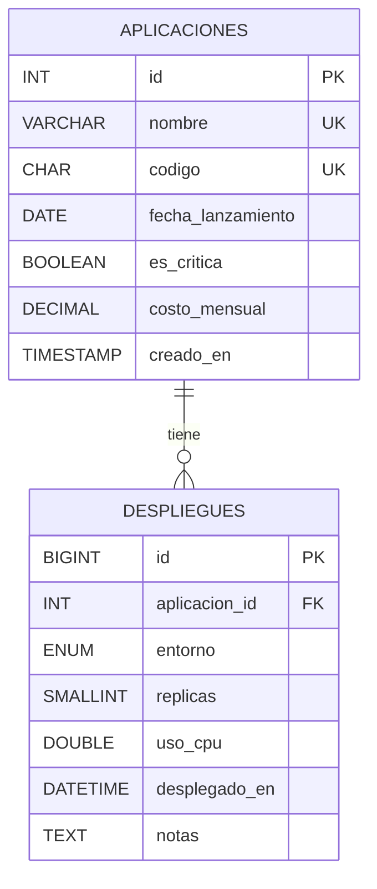
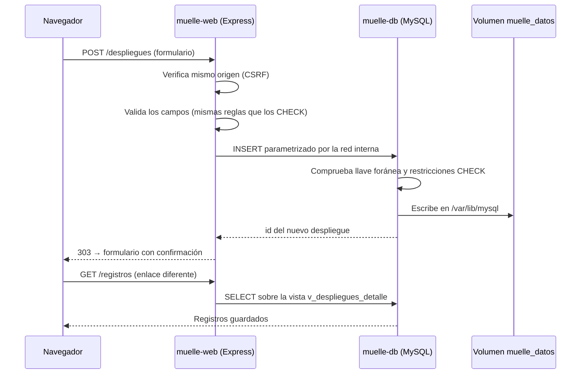

<div align="center">

# ⚓ Muelle – Aplicación Web Node.js y MySQL Contenerizada con Docker

### *Imágenes propias, Docker Compose, redes aisladas, persistencia con volúmenes y más de 40 comandos documentados*

**Módulo: Contenerización de Aplicaciones de Software · Politécnico Grancolombiano · Unidad 2**

[]()
[]()
[]()
[]()
[]()
[]()
[]()

**[Contexto](#-contexto-y-alcance) • [Contenido](#-contenido-del-repositorio) • [Tecnologías](#-tecnologías-utilizadas) • [Arquitectura](#️-arquitectura) • [Ejecución](#-ejecución) • [Pruebas](#-pruebas) • [Autor](#-autor)**


</div>

---

## 📋 Tabla de Contenidos

- [🎯 Contexto y Alcance](#-contexto-y-alcance)
- [📁 Contenido del Repositorio](#-contenido-del-repositorio)
- [🧰 Tecnologías Utilizadas](#-tecnologías-utilizadas)
- [🏗️ Arquitectura](#️-arquitectura)
- [🗃️ Modelo Entidad-Relación](#️-modelo-entidad-relación)
- [🔁 Flujo de un Registro](#-flujo-de-un-registro)
- [🧩 Del Enunciado a Muelle](#-del-enunciado-a-muelle)
- [🚀 Ejecución](#-ejecución)
- [🔌 Páginas y Endpoints](#-páginas-y-endpoints)
- [🧪 Pruebas](#-pruebas)
- [✅ Buenas Prácticas Aplicadas](#-buenas-prácticas-aplicadas)
- [🔐 Seguridad y Alcance](#-seguridad-y-alcance)
- [📝 Nota](#-nota)
- [👤 Autor](#-autor)

---

## 🎯 Contexto y Alcance

Este repositorio contiene **Muelle**, la solución de la **Actividad Sumativa de la Unidad 2: Creación de aplicación contenerizada en Docker**. Es un registro de aplicaciones y de sus despliegues: una interfaz web en **Node.js + Express** que guarda la información en **MySQL 8.4**, cada uno dentro de su propio contenedor, con **imágenes propias** para el servidor web y para la base de datos, orquestadas con **Docker Compose**.

La base de datos sigue un modelo entidad-relación **1:N** entre dos tablas de **7 columnas cada una** que, en conjunto, usan **13 tipos de datos distintos**. La aplicación permite ingresar los datos por formulario y consultarlos en un enlace diferente, y el repositorio incluye un recorrido guiado de **47 comandos Docker** para el video.

> **Aplicación:** registro de aplicaciones de software y sus despliegues por entorno.
> **Enfoque:** imágenes propias, orquestación con Compose, aislamiento de red y persistencia.
> **Alcance:** 2 imágenes propias → 2 contenedores, 2 redes (una interna) y 1 volumen con nombre → 20 registros de prueba que sobreviven a la destrucción de los contenedores.

### 🌟 ¿Qué demuestra este proyecto?

- 🏗️ **Imágenes propias** para el servidor web y para la base de datos relacional, construidas desde Dockerfiles.
- 🐳 **Orquestación con Docker Compose**: arranque ordenado, healthchecks y límites de CPU y memoria.
- 🔒 **Red interna** para MySQL: la base de datos no publica puertos y solo la ve el contenedor web.
- 💾 **Persistencia con volúmenes**: los datos sobreviven a `docker compose down` y a contenedores nuevos.
- 🗃️ **Relación 1:N con integridad referencial**: llave foránea, restricciones CHECK y validación en ambos extremos.
- 🧭 **Recorrido guiado** de 62 ejecuciones de 47 comandos Docker, organizados por componente de la arquitectura.

---

## 📁 Contenido del Repositorio

<table align="center">
  <tr><th>Elemento</th><th>Descripción</th></tr>
  <tr><td colspan="2"><b>📂 raíz</b></td></tr>
  <tr><td><code>docker-compose.yml</code></td><td>🐳 Orquesta los <b>2 contenedores</b> con dos redes (la de la base de datos es interna y no publica puertos), un volumen con nombre, healthchecks, arranque ordenado y límites de CPU y memoria</td></tr>
  <tr><td><code>.env.example</code></td><td>🔑 Plantilla para cambiar puerto y credenciales sin tocar el compose</td></tr>
  <tr><td><code>.gitattributes</code></td><td>↩️ Fuerza finales de línea LF en los scripts que corren en Linux</td></tr>
  <tr><td><code>.gitignore</code></td><td>🚫 Mantiene en local el material académico, <code>node_modules</code> y los archivos <code>.env</code></td></tr>
  <tr><td colspan="2"><b>📂 database/</b></td></tr>
  <tr><td><code>Dockerfile</code></td><td>🗄️ <b>Imagen de base de datos relacional</b> basada en <code>mysql:8.4</code>, con configuración propia y healthcheck</td></tr>
  <tr><td><code>init/01_esquema.sql</code></td><td>📜 <b>Script de la base de datos</b>: tablas <code>aplicaciones</code> y <code>despliegues</code>, llave foránea, restricciones CHECK, índices y la vista <code>v_despliegues_detalle</code></td></tr>
  <tr><td><code>init/02_privilegios.sh</code></td><td>🛡️ Aplica <b>mínimo privilegio</b>: el usuario de la app solo puede leer y escribir filas</td></tr>
  <tr><td><code>conf/muelle.cnf</code></td><td>⚙️ Configuración de MySQL: <code>utf8mb4</code>, hora de Colombia y modo estricto</td></tr>
  <tr><td colspan="2"><b>📂 web/</b></td></tr>
  <tr><td><code>Dockerfile</code></td><td>🌐 <b>Imagen del servidor web</b>: construcción en dos etapas sobre <code>node:22-alpine</code>, usuario sin privilegios y healthcheck</td></tr>
  <tr><td><code>src/</code></td><td>🧱 Aplicación <b>Express</b>: páginas EJS, API REST, validación, protección CSRF, acceso a datos con consultas parametrizadas y apagado ordenado ante SIGTERM</td></tr>
  <tr><td><code>test/</code></td><td>🧪 Pruebas unitarias de las reglas de validación (<code>npm test</code>)</td></tr>
  <tr><td colspan="2"><b>📂 demo-imagen/</b></td></tr>
  <tr><td><code>Dockerfile</code>, <code>index.html</code></td><td>🧪 Imagen mínima de nginx para mostrar en el video cómo se crea y elimina una imagen y un contenedor</td></tr>
  <tr><td colspan="2"><b>📂 scripts/</b></td></tr>
  <tr><td><code>comandos.tsv</code></td><td>📋 Catálogo de los comandos del video, con componente de la arquitectura y explicación</td></tr>
  <tr><td><code>demo-comandos.ps1</code>, <code>demo-comandos.sh</code></td><td>▶️ Ejecutan el catálogo paso a paso (Windows y Linux/macOS)</td></tr>
  <tr><td><code>prueba-humo.sh</code></td><td>✅ Prueba de punta a punta contra los contenedores: 29 verificaciones</td></tr>
  <tr><td colspan="2"><b>📂 docs/</b></td></tr>
  <tr><td><code>comandos-docker.md</code></td><td>📖 Guía de comandos organizada por componente de la arquitectura de Docker</td></tr>
  <tr><td><code>guion-video.md</code></td><td>🎥 Guion del video, alineado con la rúbrica</td></tr>
  <tr><td><code>datos-de-prueba.md</code></td><td>🗂️ Los 20 registros de ejemplo (5 aplicaciones y 15 despliegues)</td></tr>
</table>

---

## 🧰 Tecnologías Utilizadas

<div align="center">


</div>

| Componente | Uso |
|:---|:---|
| **Docker Desktop y Docker Compose v2** | Construcción de las imágenes y orquestación local de los 2 contenedores |
| **Node.js 22 + Express 4** | Servidor web: páginas, API REST, validación y protección CSRF |
| **EJS** | Plantillas de la interfaz (formularios, registros y página de contenedores) |
| **mysql2** | Pool de conexiones y consultas parametrizadas contra MySQL |
| **MySQL 8.4 LTS** | Base de datos relacional con llave foránea, restricciones CHECK y vista |
| **nginx** | Imagen mínima de demostración para el ciclo de vida de imágenes y contenedores |

---

## 🏗️ Arquitectura



El contenedor web es el único con un puerto publicado (`127.0.0.1:8080`) y está conectado a las dos redes. MySQL vive solo en `muelle_interna`, declarada `internal: true`, y el contenedor web lo encuentra por el **DNS interno** de Docker con el nombre `db`.

---

## 🗃️ Modelo Entidad-Relación



MySQL implementa `BOOLEAN` como `TINYINT(1)`, y así lo reporta la página **Contenedores**. La llave foránea usa `ON DELETE RESTRICT`: no se puede borrar una aplicación que aún tiene despliegues, y no se puede registrar un despliegue de una aplicación inexistente.

---

## 🔁 Flujo de un Registro



Si la validación falla, la página responde **422** con los errores junto a cada campo. Si MySQL rechaza el dato (duplicado o llave foránea), el error se traduce a un mensaje legible en el mismo formulario.

---

## 🧩 Del Enunciado a Muelle

| Requisito de la actividad | Cómo lo resuelve Muelle |
|:---|:---|
| **Comandos Docker** (mínimo 30) con arquitectura y usos | 62 ejecuciones de 47 comandos distintos en `scripts/comandos.tsv` y `docs/comandos-docker.md` |
| **Crear y eliminar** imágenes y contenedores | `demo-imagen/` con `docker build`, `docker rm` y `docker rmi` |
| **Imagen propia del servidor web** | `web/Dockerfile` → `muelle-web:1.0.0` |
| **Imagen propia de base de datos relacional** | `database/Dockerfile` → `muelle-db:1.0.0` |
| **Script de la base de datos** | `database/init/01_esquema.sql`, ejecutado por el entrypoint de MySQL |
| **Relación entre tablas** | `aplicaciones` 1:N `despliegues` con llave foránea |
| **Formulario de ingreso** y **enlace diferente** para consultar | `/aplicaciones/nueva`, `/despliegues/nuevo` y `/registros` |
| **15 datos persistentes** | 20 registros de prueba que sobreviven a la destrucción de los contenedores |

---

## 🚀 Ejecución

1. Instalar **Docker Desktop** (en Windows, con el motor WSL 2) y verificar con `docker version`.
2. Clonar el repositorio:
   ```bash
   git clone https://github.com/AlejoTechEngineer/muelle-docker-node-mysql.git
   cd muelle-docker-node-mysql
   ```
3. Construir las imágenes y levantar los contenedores:
   ```bash
   docker compose up -d --build
   ```
4. Esperar a que ambos servicios aparezcan como **healthy**:
   ```bash
   docker compose ps
   ```
5. Abrir **http://localhost:8080** en el navegador.

Para consultar MySQL directamente dentro de su contenedor:

```bash
docker compose exec db mysql -umuelle_app -pMuelle_App_2026 muelle -e "SELECT * FROM v_despliegues_detalle"
```

| Acción | Comando |
|:---|:---|
| ⏹️ Detener todo conservando los datos | `docker compose down` |
| 🗑️ Detener y borrar también los datos | `docker compose down -v` |
| 🔑 Cambiar puerto o credenciales | Copiar `.env.example` como `.env` y editarlo antes del primer arranque |

---

## 🔌 Páginas y Endpoints

Todos se consumen en `http://localhost:8080`.

| Página | Ruta | Para qué |
|:---|:---|:---|
| 🏠 Inicio | `/` | Resumen y avance hacia la meta de 15 registros |
| 📝 Registrar aplicación | `/aplicaciones/nueva` | Formulario de la tabla padre |
| 🚢 Registrar despliegue | `/despliegues/nuevo` | Formulario de la tabla hija |
| 📊 Registros | `/registros` | Enlace diferente que muestra lo guardado en MySQL |
| 🐳 Contenedores | `/sistema` | Evidencia de ejecución en Docker: ID de contenedor, imagen, cgroups, red y permisos |
| ❤️ Salud | `/health`, `/ready` | Usados por el healthcheck |

| Método | Ruta | Respuesta |
|:---:|:---|:---|
| `GET` | `/api/resumen` | Conteos y avance hacia la meta |
| `GET` | `/api/aplicaciones` | Lista de aplicaciones |
| `POST` | `/api/aplicaciones` | `201` con la aplicación creada, o `422` con los errores de validación |
| `DELETE` | `/api/aplicaciones/{id}` | `204`, o `404` si no existe |
| `GET` | `/api/despliegues` | Lista de despliegues con el nombre de su aplicación |
| `POST` | `/api/despliegues` | `201` con el despliegue creado, o `422` con los errores de validación |
| `DELETE` | `/api/despliegues/{id}` | `204`, o `404` si no existe |
| `GET` | `/api/sistema` | Información de los dos contenedores |

```bash
curl localhost:8080/api/resumen
curl localhost:8080/api/despliegues
curl localhost:8080/api/sistema
```

---

## 🧪 Pruebas

```bash
# Pruebas unitarias de validación (sin Docker)
cd web && npm install && npm test

# Prueba de punta a punta contra los contenedores en ejecución
./scripts/prueba-humo.sh http://localhost:8080
```

La prueba de punta a punta inserta 5 aplicaciones y 15 despliegues por la API, verifica que se rechacen datos inválidos y duplicados, comprueba la integridad referencial en ambos sentidos y confirma que los registros quedaron persistidos. Escribe datos reales: para empezar de cero, `docker compose down -v`.

<details>
<summary><b>💾 Ver prueba de persistencia</b></summary>

La prueba de persistencia está en la sección 3 del recorrido guiado: se destruyen los contenedores, se crean otros nuevos y los datos siguen en el volumen.

| Paso | Comando | Qué observar |
|:---:|:---|:---|
| 1 | `docker compose exec db mysql ... -e "SELECT COUNT(*) ..."` | Conteo de registros antes de destruir |
| 2 | `docker compose stop web` | Node recibe SIGTERM y se apaga de forma ordenada |
| 3 | `docker compose down` | Se eliminan contenedores y redes; el volumen `muelle_datos` **no** se borra |
| 4 | `docker ps -a` y `docker volume ls` | No queda ningún contenedor de Muelle, pero el volumen sigue ahí |
| 5 | `docker compose up -d` | Contenedores **nuevos** (otros ID) que montan el mismo volumen |
| 6 | `docker compose exec db mysql ... -e "SELECT COUNT(*) ..."` | Los mismos conteos: los datos sobrevivieron |

</details>

---

## ✅ Buenas Prácticas Aplicadas

| Práctica | Dónde se aplica |
|:---|:---|
| 🏗️ **Imágenes propias** con etiquetas OCI y versión fija | `web/Dockerfile`, `database/Dockerfile` |
| 📦 Construcción **multietapa** y `.dockerignore`: la imagen final no lleva herramientas de construcción, pruebas ni caché | `web/Dockerfile`, `web/.dockerignore` |
| 👤 Proceso web con **usuario sin privilegios**, sistema de archivos de **solo lectura**, sin capacidades del kernel y con `no-new-privileges` | `web/Dockerfile`, `docker-compose.yml` |
| ❤️ **Healthchecks** en las dos imágenes y arranque condicionado (`service_healthy`) | Dockerfiles, `depends_on` |
| 🔒 **Red interna** para MySQL: sin puertos publicados, solo alcanzable por DNS de Docker | `docker-compose.yml` |
| 💾 **Volumen con nombre**, independiente del ciclo de vida de los contenedores | `muelle_datos` |
| 🛡️ **Mínimo privilegio** en MySQL y **consultas parametrizadas** contra inyección SQL | `02_privilegios.sh`, `web/src/db.js` |
| 🚫 **Protección CSRF** sin sesiones: se rechaza (403) lo que el navegador marca, con `Sec-Fetch-Site` u `Origin`, como proveniente de otro sitio | `web/src/server.js` |
| 🏠 Puerto publicado **solo en `127.0.0.1`** | `docker-compose.yml` |
| ✔️ Validación en el navegador y en el servidor, replicando las restricciones CHECK | `web/src/validadores.js` |
| ⏱️ **Apagado ordenado** ante SIGTERM; `init: true` agrega un PID 1 que reenvía señales | `web/src/server.js`, `docker-compose.yml` |
| 🔑 Configuración por **variables de entorno**, sin secretos en el código | `docker-compose.yml`, `.env.example` |
| ↩️ Finales de línea **LF** forzados para que el proyecto funcione aunque se clone en Windows | `.gitattributes` |

---

## 🔐 Seguridad y Alcance

Muelle es un laboratorio académico pensado para ejecutarse en el equipo local. Por eso:

- **No tiene autenticación de usuarios.** Cualquiera que acceda a la interfaz puede crear y eliminar registros. Se mitiga publicando el puerto solo en `127.0.0.1` y rechazando peticiones de otros sitios (CSRF). En un despliegue real habría que agregar inicio de sesión, por ejemplo con un proveedor OIDC detrás de un proxy inverso.
- **Las credenciales por defecto de `docker-compose.yml` son públicas** y sirven solo para desarrollo. Para cualquier otro uso, define valores propios en `.env` (ver `.env.example`) antes del primer arranque o, mejor, usa Docker secrets: la aplicación ya admite `DB_PASSWORD_FILE` y la imagen de MySQL admite `MYSQL_PASSWORD_FILE`.
- MySQL no publica puertos y solo es alcanzable por la red interna de Docker.

---

## 📝 Nota

Este proyecto corresponde a una **actividad académica** y se elaboró con fines exclusivamente formativos. Las aplicaciones y los despliegues de los datos de prueba son ficticios.

---

## 👤 Autor

<div align="center">

Este proyecto fue desarrollado en el marco del módulo **Contenerización de Aplicaciones de Software** de la **Maestría en Arquitectura de Software** del **Politécnico Grancolombiano** (Bogotá, Colombia).

| Autor | Perfil |
|:---:|:---:|
| ***Alejandro De Mendoza*** | [](https://github.com/AlejoTechEngineer) |

</div>

---

<div align="center">

### ⚓ *Un contenedor es efímero; los datos, no*

**Contenerización de Aplicaciones de Software · Muelle**

</div>
