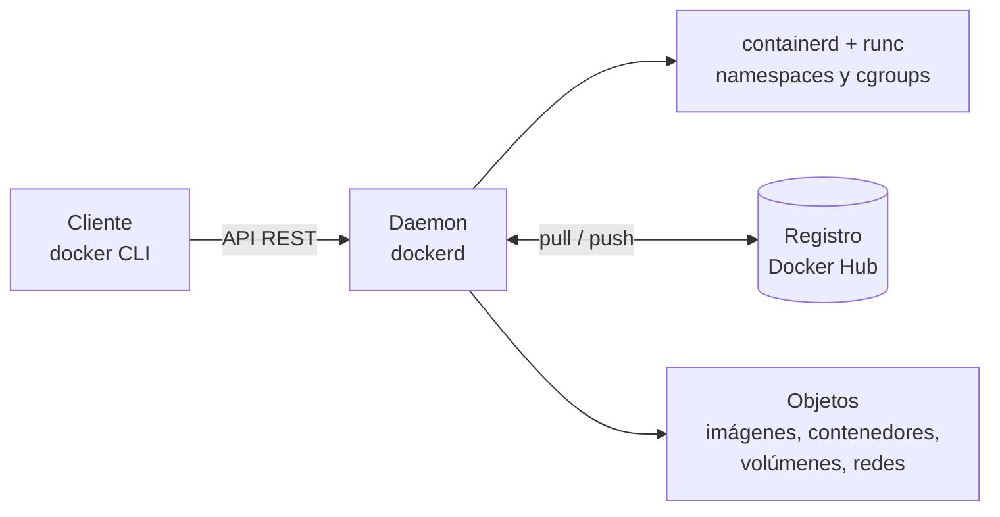
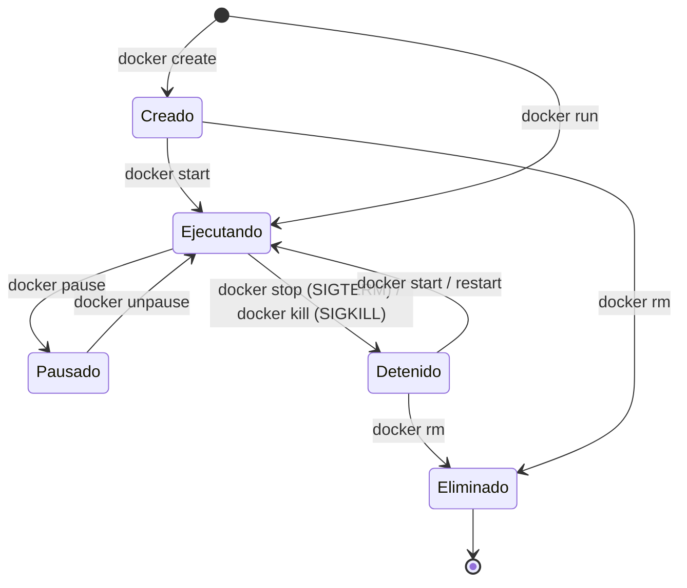

# Comandos Docker por componente de la arquitectura

Este documento acompaña el video. Reúne **62 ejecuciones** de **47 comandos distintos** que se muestran en vivo, más 13 comandos de consulta que completan el panorama. La rúbrica pide al menos 30.

Todos los comandos del video están en [`scripts/comandos.tsv`](../scripts/comandos.tsv) y se ejecutan paso a paso con `scripts/demo-comandos.ps1` (Windows) o `scripts/demo-comandos.sh` (Linux, macOS o Git Bash).

## La arquitectura en una frase por componente

Docker sigue un modelo **cliente-servidor**. El **cliente** (`docker`, la CLI) no crea contenedores: traduce cada comando en una llamada a la **API REST** del **daemon** (`dockerd`), que es quien administra los **objetos** (imágenes, contenedores, volúmenes y redes). Cuando el daemon necesita una imagen que no tiene, la descarga de un **registro** (Docker Hub por defecto). Por debajo, el daemon delega en `containerd` y `runc`, que usan dos funciones del kernel de Linux: los **namespaces** (aislamiento: cada contenedor ve sus propios procesos, red y sistema de archivos) y los **cgroups** (límites de CPU y memoria). En Windows, Docker Desktop ejecuta ese kernel de Linux dentro de WSL 2.

## Ciclo de vida de un contenedor

## Sección 1. Fundamentos: crear y eliminar imágenes y contenedores

| # | Componente | Comando | Qué hace |
|---:|---|---|---|
| 1 | Cliente y daemon | `docker version` | Muestra la versión del cliente (CLI) y del servidor (dockerd). Son dos programas distintos que hablan por la API REST. |
| 2 | Cliente y daemon | `docker info` | Estado del daemon: contenedores, imágenes, driver de almacenamiento, cgroups y recursos del host. |
| 3 | Cliente y daemon | `docker context ls` | Lista los daemons a los que el cliente puede conectarse. Un mismo cliente puede manejar daemons locales o remotos. |
| 4 | Registro | `docker search nginx --limit 5` | Busca imágenes en el registro público (Docker Hub). |
| 5 | Registro | `docker pull hello-world` | Descarga una imagen del registro al host local, capa por capa. |
| 6 | Registro | `docker run --rm hello-world` | run = pull (si falta) + create + start. --rm borra el contenedor al terminar. |
| 7 | Imágenes | `docker build -t hola-poli:1.0 ./demo-imagen` | CREA una imagen propia a partir de un Dockerfile. Cada instrucción genera una capa. |
| 8 | Imágenes | `docker images` | Lista las imágenes locales con su etiqueta, ID y tamaño. |
| 9 | Imágenes | `docker history hola-poli:1.0` | Muestra las capas de la imagen y la instrucción que creó cada una. |
| 10 | Imágenes | `docker image inspect hola-poli:1.0 --format "{{.Config.Labels}}"` | Metadatos de la imagen en JSON; aquí solo las etiquetas LABEL. |
| 11 | Imágenes | `docker tag hola-poli:1.0 hola-poli:latest` | Agrega otra etiqueta a la misma imagen (mismo ID, sin copiar datos). |
| 12 | Contenedores | `docker create --name hola -p 8081:80 hola-poli:1.0` | CREA un contenedor sin iniciarlo (estado Created). Publica el puerto 80 en el 8081 del equipo. |
| 13 | Contenedores | `docker ps -a` | Lista todos los contenedores, también los detenidos o solo creados. |
| 14 | Contenedores | `docker start hola` | Inicia el contenedor creado: pasa a estado Running. Abre http://localhost:8081 |
| 15 | Contenedores | `docker ps` | Lista solo los contenedores en ejecución. |
| 16 | Contenedores | `docker logs hola` | Salida estándar del proceso principal del contenedor (aquí, los accesos de nginx). |
| 17 | Contenedores | `docker exec hola ls -l /usr/share/nginx/html` | Ejecuta un comando dentro del contenedor en marcha. |
| 18 | Contenedores | `docker top hola` | Procesos que corren dentro del contenedor, vistos desde el host. |
| 19 | Contenedores | `docker stats --no-stream hola` | Consumo de CPU, memoria, red y disco del contenedor (medido por cgroups). |
| 20 | Contenedores | `docker port hola` | Mapeo de puertos entre el contenedor y el equipo. |
| 21 | Contenedores | `docker pause hola` | Congela todos los procesos (señal SIGSTOP vía cgroup freezer). La memoria se conserva. |
| 22 | Contenedores | `docker unpause hola` | Reanuda los procesos congelados. |
| 23 | Contenedores | `docker rename hola hola-poli` | Cambia el nombre del contenedor. |
| 24 | Contenedores | `docker restart hola-poli` | Detiene e inicia de nuevo el contenedor. |
| 25 | Contenedores | `docker cp ./demo-imagen/index.html hola-poli:/tmp/copia.html` | Copia archivos entre el equipo y el contenedor. |
| 26 | Contenedores | `docker diff hola-poli` | Cambios en la capa escribible del contenedor (A = agregado, C = cambiado, D = borrado). |
| 27 | Contenedores | `docker inspect hola-poli --format "{{.State.Status}} {{.NetworkSettings.IPAddress}}"` | Detalle completo del contenedor; aquí su estado y su IP en la red bridge. |
| 28 | Contenedores | `docker stop hola-poli` | Detiene el contenedor: SIGTERM y, si no termina en 10 s, SIGKILL. |
| 29 | Contenedores | `docker rm hola-poli` | ELIMINA el contenedor detenido. |
| 30 | Contenedores | `docker run -d --name efimero hola-poli:1.0` | Crea e inicia un segundo contenedor en segundo plano (-d). |
| 31 | Contenedores | `docker kill efimero` | Termina el proceso de inmediato con SIGKILL, sin apagado ordenado. |
| 32 | Contenedores | `docker rm efimero` | Elimina el contenedor terminado. |
| 33 | Imágenes | `docker rmi hola-poli:latest hola-poli:1.0` | ELIMINA la imagen (sus dos etiquetas). Solo se puede si ningún contenedor la usa. |
| 34 | Volúmenes | `docker volume create vol-prueba` | Crea un volumen: almacenamiento que vive fuera del ciclo de vida del contenedor. |
| 35 | Volúmenes | `docker volume ls` | Lista los volúmenes. |
| 36 | Volúmenes | `docker volume inspect vol-prueba` | Detalle del volumen, incluido su punto de montaje en el host. |
| 37 | Volúmenes | `docker volume rm vol-prueba` | Elimina el volumen. |
| 38 | Redes | `docker network ls` | Lista las redes: bridge, host, none y las creadas por el usuario. |
| 39 | Redes | `docker network create red-prueba` | Crea una red bridge propia, con DNS interno entre contenedores. |
| 40 | Redes | `docker network inspect red-prueba` | Detalle de la red: subred, puerta de enlace y contenedores conectados. |
| 41 | Redes | `docker network rm red-prueba` | Elimina la red. |
| 42 | Sistema | `docker system df` | Espacio que ocupan imágenes, contenedores, volúmenes y caché de construcción. |

## Sección 2. Despliegue de Muelle con Docker Compose

| # | Componente | Comando | Qué hace |
|---:|---|---|---|
| 43 | Compose | `docker compose config --services` | Valida docker-compose.yml y lista sus servicios. |
| 44 | Compose | `docker compose build` | Construye las dos imágenes del proyecto: muelle-db y muelle-web. |
| 45 | Imágenes | `docker images muelle-*` | Las dos imágenes recién creadas. |
| 46 | Compose | `docker compose up -d` | Crea redes, volumen y contenedores; db primero y web cuando db está sano. |
| 47 | Compose | `docker compose ps` | Estado de los servicios; espera a que ambos digan (healthy). |
| 48 | Compose | `docker compose logs --tail 15 db` | Registro de MySQL: ejecución de los scripts de /docker-entrypoint-initdb.d. |
| 49 | Compose | `docker compose logs --tail 10 web` | Registro de Node.js: conexión con la base y puerto en escucha. |
| 50 | Compose | `docker compose exec db mysql -umuelle_app -pMuelle_App_2026 muelle -e "SHOW TABLES"` | Consulta directa a MySQL dentro de su contenedor. |
| 51 | Compose | `docker compose exec web id` | El proceso web corre como usuario node (uid 1000), no como root. |
| 52 | Redes | `docker network inspect muelle_interna --format "{{range .Containers}}{{.Name}} {{.IPv4Address}} {{end}}"` | Contenedores conectados a la red interna y sus IP. |
| 53 | Volúmenes | `docker volume inspect muelle_datos` | Volumen donde MySQL guarda los datos (/var/lib/mysql). |

## Sección 3. Prueba de persistencia

| # | Componente | Comando | Qué hace |
|---:|---|---|---|
| 54 | Persistencia | `docker compose exec db mysql -umuelle_app -pMuelle_App_2026 muelle -e "SELECT COUNT(*) AS aplicaciones FROM aplicaciones; SELECT COUNT(*) AS despliegues FROM despliegues"` | Cuántos registros hay en MySQL antes de destruir los contenedores. |
| 55 | Persistencia | `docker compose stop web` | Detiene el contenedor web. Node recibe SIGTERM y se apaga de forma ordenada. |
| 56 | Persistencia | `docker compose logs --tail 4 web` | Evidencia del apagado ordenado (mensaje SIGTERM recibido). |
| 57 | Persistencia | `docker compose down` | ELIMINA los contenedores y las redes. El volumen muelle_datos NO se borra. |
| 58 | Persistencia | `docker ps -a` | Ya no existe ningún contenedor de Muelle. |
| 59 | Persistencia | `docker volume ls` | El volumen muelle_datos sigue ahí con los datos. |
| 60 | Persistencia | `docker compose up -d` | Crea contenedores NUEVOS (otros ID) que montan el mismo volumen. |
| 61 | Persistencia | `docker compose ps` | Espera a que ambos servicios estén (healthy). |
| 62 | Persistencia | `docker compose exec db mysql -umuelle_app -pMuelle_App_2026 muelle -e "SELECT COUNT(*) AS aplicaciones FROM aplicaciones; SELECT COUNT(*) AS despliegues FROM despliegues"` | Mismos conteos: los datos sobrevivieron a la destrucción de los contenedores. |

## Comandos de consulta adicionales

No se ejecutan en el video para no alterar el entorno (algunos borran datos o requieren cuenta en Docker Hub), pero forman parte del repertorio diario.

| Componente | Comando | Qué hace |
|---|---|---|
| Registro | `docker login` | Autentica el cliente contra un registro (Docker Hub o uno privado). |
| Registro | `docker push usuario/hola-poli:1.0` | Sube una imagen etiquetada al registro para distribuirla. |
| Imágenes | `docker save -o hola.tar hola-poli:1.0` | Exporta una imagen a un archivo .tar (útil sin acceso a un registro). |
| Imágenes | `docker load -i hola.tar` | Importa una imagen desde un archivo .tar. |
| Imágenes | `docker commit hola-poli hola-poli:modificada` | Crea una imagen a partir del estado actual de un contenedor (no reemplaza al Dockerfile). |
| Imágenes | `docker image prune -f` | Borra imágenes huérfanas (sin etiqueta). |
| Contenedores | `docker attach hola-poli` | Conecta la terminal a la entrada y salida del proceso principal. |
| Contenedores | `docker wait hola-poli` | Espera a que el contenedor termine y devuelve su código de salida. |
| Contenedores | `docker container prune -f` | Elimina todos los contenedores detenidos. |
| Redes | `docker network connect red-prueba hola-poli` | Conecta un contenedor en ejecución a otra red. |
| Sistema | `docker events` | Flujo en vivo de eventos del daemon (create, start, die, destroy...). |
| Sistema | `docker system prune` | Limpia contenedores detenidos, redes sin uso, imágenes huérfanas y caché. |
| Compose | `docker compose down -v` | Elimina contenedores, redes Y volúmenes: borra los datos de MySQL. |

## Diferencias que vale la pena explicar en el video

`docker create` deja el contenedor listo pero detenido; `docker start` lo arranca; `docker run` hace las dos cosas (y descarga la imagen si falta).

`docker pause` congela los procesos y conserva su memoria; `docker stop` los termina con SIGTERM y, pasados 10 segundos, con SIGKILL; `docker kill` envía SIGKILL de inmediato. La aplicación Muelle escucha SIGTERM para cerrar sus conexiones antes de salir: se ve en `docker compose logs web` después de `docker compose stop web`.

`docker rm` elimina un contenedor; `docker rmi` elimina una imagen. Una imagen no se puede borrar mientras un contenedor la use.

`docker compose down` elimina contenedores y redes pero conserva los volúmenes; `docker compose down -v` también borra los volúmenes y con ellos los datos.

---
Comandos distintos usados en el video: `docker build`, `docker compose build`, `docker compose config`, `docker compose down`, `docker compose exec`, `docker compose logs`, `docker compose ps`, `docker compose stop`, `docker compose up`, `docker context ls`, `docker cp`, `docker create`, `docker diff`, `docker exec`, `docker history`, `docker image inspect`, `docker images`, `docker info`, `docker inspect`, `docker kill`, `docker logs`, `docker network create`, `docker network inspect`, `docker network ls`, `docker network rm`, `docker pause`, `docker port`, `docker ps`, `docker pull`, `docker rename`, `docker restart`, `docker rm`, `docker rmi`, `docker run`, `docker search`, `docker start`, `docker stats`, `docker stop`, `docker system df`, `docker tag`, `docker top`, `docker unpause`, `docker version`, `docker volume create`, `docker volume inspect`, `docker volume ls`, `docker volume rm`.
